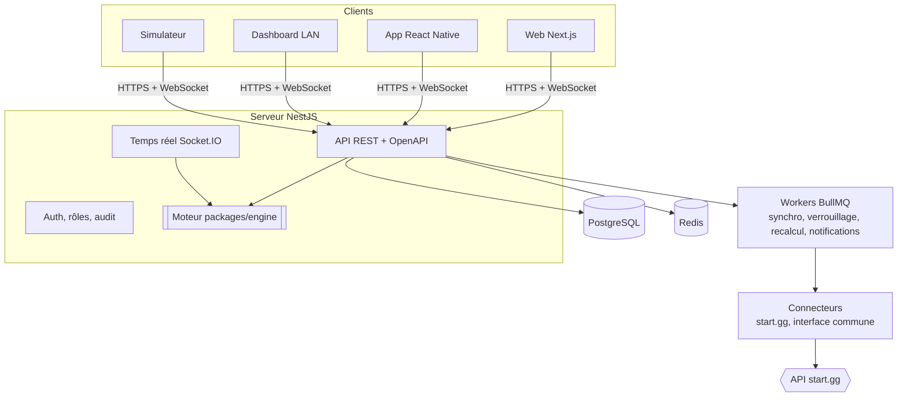

# Architecture

Un résultat suit toujours le même chemin, qu'il soit saisi, déclaré, importé par fichier ou synchronisé depuis start.gg : il est enregistré comme événement, le moteur recalcule l'arbre, les pronostics et le Pick'em, puis le temps réel diffuse le nouvel état.

## Composants

| Composant   | Rôle                                                                                                 | Dossier                   |
| ----------- | ---------------------------------------------------------------------------------------------------- | ------------------------- |
| Moteur      | Logique pure : arbres, suisse, FFA, qualifications, départage, barèmes, résolution Pick'em, recalcul | `packages/engine`         |
| API         | REST, validation, permissions, persistance                                                           | `apps/api`                |
| Temps réel  | Rooms par tournoi et par match, diffusion des résultats et classements                               | `apps/api` (gateway)      |
| Workers     | Jobs différés : synchro start.gg, verrouillage, recalcul en cascade, notifications                   | `apps/api`                |
| Connecteurs | Traduisent une source externe vers le modèle de la plateforme                                        | `apps/api/src/connectors` |
| Web         | Public, joueur, administration, dashboard plein écran                                                | `apps/web`                |
| Mobile      | Suivi, pronostics, Pick'em, notifications                                                            | `apps/mobile`             |
| Simulateur  | Joueurs, équipes, matchs et pronostics fictifs, en accéléré ou en temps réel                         | `apps/simulator`          |

## Choix de stack

Chaque choix est justifié dans un ADR :

- [0001 Monorepo TypeScript](adr/0001-monorepo-typescript.md)
- [0002 API NestJS + Fastify + Prisma](adr/0002-api-nestjs-prisma.md)
- [0003 Mobile React Native avec Expo, cible Android](adr/0003-mobile-react-native-expo.md)
- [0004 Hébergement](adr/0004-hebergement.md)
- [0005 Résultats en événements et recalcul en cascade](adr/0005-recalcul-par-evenements.md)
