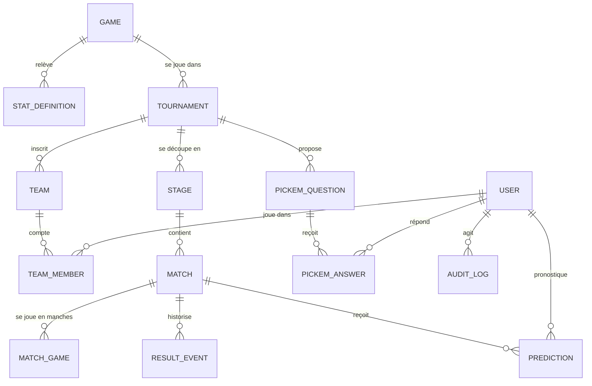

# Modèle de données

Référence : [`apps/api/prisma/schema.prisma`](../apps/api/prisma/schema.prisma). Première version (sprint 0), à faire évoluer avec le schéma.

## Dictionnaire des champs (extrait)

| Entité         | Champ        | Sens                                                                       |
| -------------- | ------------ | -------------------------------------------------------------------------- |
| Tournament     | `source`     | `INTERNAL`, `FILE_IMPORT` ou `STARTGG`                                     |
| Tournament     | `externalId` | Identifiant start.gg d'un tournoi importé                                  |
| Tournament     | `readOnly`   | Vrai pour un import : les résultats viennent de la source                  |
| Stage          | `settings`   | BO par tour, barème de points, règles de départage, seeding                |
| Match          | `startedAt`  | Début réel, sur l'horloge du serveur : verrouille les pronostics           |
| Match          | `slots`      | Participants par emplacement (2 en duel, N en FFA)                         |
| ResultEvent    | `payload`    | Résultat brut ; l'état courant est recalculé à partir de ces événements    |
| PickemQuestion | `template`   | `most_picked`, `best_on_stat`, `total`, `ranking`, `yes_no`                |
| PickemQuestion | `status`     | `open`, `locked`, `resolved`, `cancelled`                                  |
| AuditLog       | `action`     | `score.corrected`, `dispute.decided`, `pickem.created`, `pickem.resolved`… |

À compléter au fil des sprints : groupes d'amis, classements matérialisés, badges, litiges, inscriptions et champs personnalisés.
