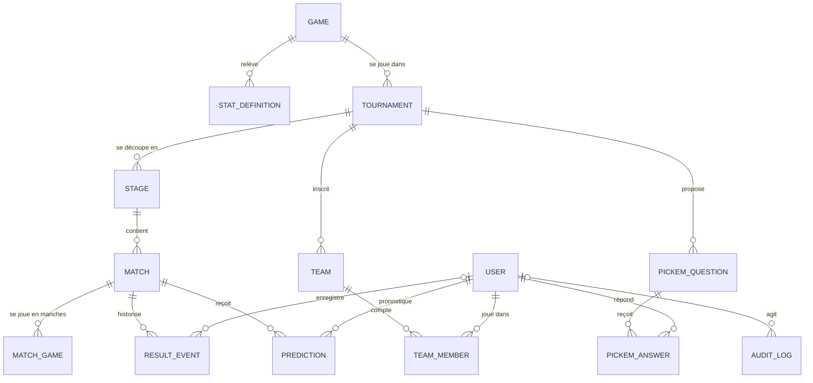

# Modèle de données

Référence : [`apps/api/prisma/schema.prisma`](../apps/api/prisma/schema.prisma). Première version (sprint 0), à faire évoluer avec le schéma.

## Dictionnaire des champs

| Entité         | Champ                             | Sens                                                                                           |
| -------------- | --------------------------------- | ---------------------------------------------------------------------------------------------- |
| User           | `role`                            | Enum `Role` : `ADMIN`, `PLAYER`, `SPECTATOR`                                                   |
| StatDefinition | `kind`, `choices`                 | Enum `StatKind` : `CHOICE`, `NUMBER`, `PLAYER` ; `choices` liste les valeurs possibles         |
| Tournament     | `source`                          | Enum `Source` : `INTERNAL`, `FILE_IMPORT` ou `STARTGG`                                         |
| Tournament     | `externalId`                      | Identifiant start.gg d'un tournoi importé                                                      |
| Tournament     | `location`                        | Enum `LocationType` : `ONLINE`, `ONSITE`, `MIXED`                                              |
| Tournament     | `teamSize`, `maxSubs`, `capacity` | Taille d'équipe (1 = solo), remplaçants maximum, nombre de places                              |
| Tournament     | `description`, `rules`            | Présentation et règlement (texte libre, optionnels)                                            |
| Tournament     | `readOnly`                        | Vrai pour un import : les résultats viennent de la source                                      |
| Stage          | `format`                          | Enum `StageFormat` : élimination simple ou double, poules, suisse, FFA                         |
| Stage          | `settings`                        | BO par tour, barème de points, règles de départage, seeding                                    |
| Team           | `checkedIn`                       | Équipe présente au check-in                                                                    |
| TeamMember     | `isCaptain`, `isSub`              | Capitaine ; remplaçant                                                                         |
| Match          | `status`                          | Enum `MatchStatus` : `SCHEDULED`, `CALLED`, `LIVE`, `DISPUTED`, `DONE`, `FORFEIT`              |
| Match          | `startedAt`                       | Début réel, sur l'horloge du serveur : verrouille les pronostics                               |
| Match          | `slots`                           | Participants par emplacement (2 en duel, N en FFA)                                             |
| MatchGame      | `result`, `stats`                 | Résultat de la manche et statistiques relevées (JSON)                                          |
| ResultEvent    | `type`                            | Enum `ResultEventType` : `ENTERED`, `DECLARED`, `CONFIRMED`, `CORRECTED`, `IMPORTED`, `SYNCED` |
| ResultEvent    | `source`                          | Origine du résultat (enum `Source`)                                                            |
| ResultEvent    | `payload`                         | Résultat brut ; l'état courant est recalculé à partir de ces événements                        |
| ResultEvent    | `actorId`                         | Auteur de l'événement ; vide pour un import ou une synchro automatique                         |
| Prediction     | `winner`                          | Vainqueur pronostiqué (identifiant de l'équipe — à confirmer)                                  |
| Prediction     | `score`, `points`                 | Score pronostiqué (optionnel) ; points attribués après résolution, vides avant                 |
| PickemQuestion | `template`                        | Enum `PickemTemplate` : `MOST_PICKED`, `BEST_ON_STAT`, `TOTAL`, `RANKING`, `YES_NO`            |
| PickemQuestion | `status`                          | Enum `PickemStatus` : `OPEN` (défaut), `LOCKED`, `RESOLVED`, `CANCELLED`                       |
| PickemQuestion | `closesAt`, `answer`              | Clôture des réponses ; réponse correcte, renseignée à la résolution                            |
| AuditLog       | `action`                          | `score.corrected`, `dispute.decided`, `pickem.created`, `pickem.resolved`…                     |
| AuditLog       | `actorId`                         | Auteur de l'action ; vide pour une action automatique (synchro start.gg)                       |
| AuditLog       | `before`, `after`                 | État avant et après la modification                                                            |

## Contraintes et index

- **Unicité** : `Tournament` (source, externalId) pour que l'import soit idempotent ; `Stage` (tournoi, ordre) ; `Match` (étape, tour, numéro) ; `MatchGame` (match, numéro) ; `Prediction` (utilisateur, match) ; `PickemAnswer` (question, utilisateur) ; `StatDefinition` (jeu, clé).
- **Index** sur les clés étrangères les plus utilisées : `Tournament.gameId`, `Team.tournamentId`, `TeamMember.userId`, `Prediction.matchId`, `PickemQuestion.tournamentId`, `ResultEvent` (match, date) et (acteur), `AuditLog` (acteur), (cible) et (date).
- **Suppression** : les données d'un tournoi (étapes, équipes, matchs, questions) sont supprimées en cascade avec lui. Un utilisateur ayant des pronostics, réponses ou appartenances d'équipe ne peut pas être supprimé.

## Décisions de conception

- Les résultats sont stockés comme `ResultEvent` ; l'état est recalculé depuis cet historique (ADR 0005).
- Le verrouillage des pronostics s'appuie sur `Match.startedAt`, comparé à l'horloge du serveur.
- `AuditLog` et `ResultEvent` sont en ajout seul : aucune mise à jour ni suppression applicative.

## Migrations

- Créer : `pnpm --filter @lislestart/api db:migrate --name <nom>`.
- Données de démo : `pnpm --filter @lislestart/api db:seed`.
- Toujours committer `apps/api/prisma/migrations/`. Ne jamais modifier une migration déjà mergée : en ajouter une nouvelle.

## Prévu

- Inscriptions (statut, check-in, champs personnalisés) : sprint 1.
- Litiges : sprint 2.
- Classements, groupes d'amis, badges : sprint 4.
