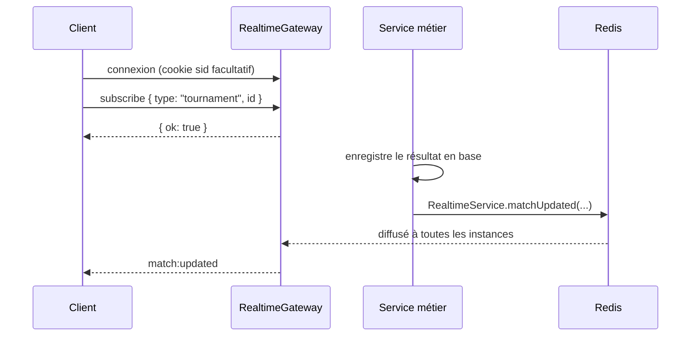

# Temps réel

Les clients (web, mobile, dashboard) reçoivent les changements de match et de classement sans recharger. Socket.IO est servi par l'API, sur le même port qu'elle (chemin `/socket.io`).

## Principe



1. Le client se connecte. Son cookie de session, s'il en a un, l'identifie ; sinon il est anonyme.
2. Il s'abonne à une **room** : `tournament:<id>` (tout le tournoi) ou `match:<id>` (un seul match).
3. Quand un service enregistre un changement en base, il appelle `RealtimeService`, qui diffuse aux rooms concernées.

## Contrat

Les types sont dans `packages/shared` (`ServerToClientEvents`, `ClientToServerEvents`), à utiliser tels quels côté web et mobile.

### Client → serveur

| Événement     | Données                                 | Réponse (accusé)                         |
| ------------- | --------------------------------------- | ---------------------------------------- |
| `subscribe`   | `{ type: "tournament" \| "match", id }` | `{ ok: true }` ou `{ ok: false, error }` |
| `unsubscribe` | idem                                    | `{ ok: true }`                           |

Refus possibles, en français : abonnement mal formé, tournoi ou match introuvable, limite de 20 abonnements par connexion.

### Serveur → client

| Événement           | Envoyé à                     | Données                                                                                    |
| ------------------- | ---------------------------- | ------------------------------------------------------------------------------------------ |
| `match:updated`     | rooms du tournoi et du match | `tournamentId`, `matchId`, `status`, `slots` (participant, score), `winnerId`, `updatedAt` |
| `standings:updated` | room du tournoi              | `tournamentId`, `updatedAt` : le client recharge le classement par HTTP                    |

Un client abonné à la fois au tournoi et au match reçoit `match:updated` une seule fois.

`standings:updated` ne contient pas le classement : envoyer un gros tableau à des milliers de spectateurs coûterait cher, alors qu'un rechargement HTTP peut être mis en cache.

### Exemple (web ou mobile)

```ts
import type { ClientToServerEvents, ServerToClientEvents } from "@lislestart/shared";
import { io, type Socket } from "socket.io-client";

const socket: Socket<ServerToClientEvents, ClientToServerEvents> = io(API_URL, {
  withCredentials: true, // envoie le cookie de session
});

socket.on("connect", async () => {
  // À refaire à chaque reconnexion : les rooms sont perdues quand la connexion tombe
  const ack = await socket.emitWithAck("subscribe", { type: "tournament", id: tournamentId });
  if (!ack.ok) console.warn(ack.error);
});

socket.on("match:updated", (event) => {
  // Mettre à jour le match affiché ; annoncer le changement avec aria-live="polite" côté web
});
```

## Côté serveur : diffuser un changement

`RealtimeService` est global : tout service peut l'injecter. On l'appelle **après** l'écriture en base, pour ne pas annoncer un résultat qui serait ensuite annulé :

```ts
constructor(private readonly realtime: RealtimeService) {}

// après la transaction qui enregistre le ResultEvent et recalcule le match
this.realtime.matchUpdated({ tournamentId, matchId, status: "done", slots, winnerId, updatedAt });
this.realtime.standingsUpdated({ tournamentId, updatedAt });
```

À brancher dans : la saisie et la validation de résultat, la décision de litige, la synchronisation start.gg et le recalcul en cascade.

## Accès

- Un tournoi **public** se suit sans compte, comme ses pages publiques.
- Un tournoi **privé** est réservé aux administrateurs pour l'instant. Avec les inscriptions, on ajoutera ses participants.
- Une room inexistante et une room privée renvoient le même message, pour ne pas révéler qu'un tournoi privé existe.
- Le client ne peut qu'écouter : aucun événement client ne modifie de donnée. Les écritures passent par l'API HTTP, avec ses gardes.

## Plusieurs instances : adaptateur Redis

`RedisIoAdapter` (`apps/api/src/realtime/realtime.adapter.ts`) relie les serveurs Socket.IO par Redis en pub/sub : un événement émis par une instance atteint les clients connectés aux autres. Il utilise deux connexions au Redis de `REDIS_URL`, en plus de celle des sessions. Les tests automatiques utilisent l'adaptateur en mémoire ; le passage par Redis a été vérifié en lançant deux instances.

## Tests

`apps/api/test/realtime.e2e.test.ts` lance l'API sur un port libre et s'y connecte avec `socket.io-client` : diffusion par room, pas de doublon, désabonnement, accès aux tournois privés, abonnements mal formés et limite par connexion.
